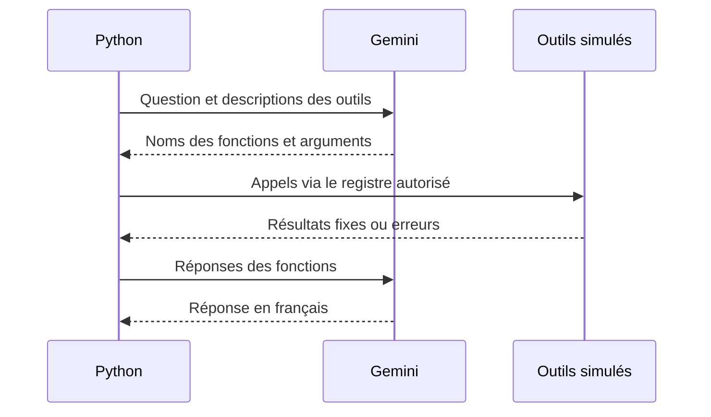

# Agent Python et choix des outils

## Objectif et état actuel

L’agent doit répondre en français à des questions sur les observations de biodiversité. Gemini choisit des fonctions métier ; Python les exécute puis lui transmet leurs résultats.

Aujourd’hui, **aucun outil ne consulte PostgreSQL** : `get_observation_count` retourne toujours `127` et `get_data_freshness` toujours `2026-10-20`. Ces valeurs sont illustratives.

## Organisation

| Fichier dans `agent/` | Responsabilité |
| --- | --- |
| `tools.py` | Fonctions métier simulées, décrites par leurs signatures et docstrings. |
| `orchestrator.py` | Exécution des noms autorisés et construction des réponses SDK. |
| `structured_query.py` | Modèle Pydantic `ObservationQuery` : genre et année entre 1800 et 2026. Contient un exemple construit à l’import. |
| `test_orchestrator.py` | Trois scénarios locaux avec appels simulés : comptage, fraîcheur, puis les deux. |
| `test_tool_calling.py` | Démonstration avec Gemini choisissant les outils. |
| `test_gemini.py` | Autre parcours : extraction JSON structurée puis appel explicite au comptage. |

## Fonctionnement



`available_tools` associe chaque nom autorisé à une fonction. L’orchestrateur n’évalue pas du code envoyé par le modèle. Un nom inconnu ou une exception devient une réponse d’erreur ; les appels suivants continuent.

`automatic_function_calling.disable=True` désactive l’exécution automatique du SDK. Le mode `AUTO` laisse Gemini répondre directement ou demander un outil. Le script gère un seul retour de résultats au modèle, sans boucle pour de nouveaux appels. L’orchestrateur attend une liste d’appels ; le script principal vérifie sa présence.

## Installation et essai local

Depuis la racine, avec Python 3.12 :

```bash
python -m venv .venv-agent
source .venv-agent/bin/activate
python -m pip install google-genai pydantic python-dotenv
python agent/test_orchestrator.py
```

Ce dernier script ne nécessite ni clé API ni PostgreSQL. Malgré leur nom, les fichiers `test_*.py` sont des démonstrations exécutées au niveau du module, avec des assertions de validation dans `test_orchestrator.py`. Ne pas les importer ou lancer une collecte de tests en supposant qu’ils sont sans effets externes.

## Démonstrations Gemini

Fournir `GEMINI_API_KEY` via les paramètres sécurisés du cloud ou un `.env` local ignoré par Git. Ne jamais versionner ni partager la clé. Le réseau doit autoriser `generativelanguage.googleapis.com` ; les appels consomment le quota du compte.

```bash
python agent/test_tool_calling.py
```

Ce script charge `.env`. En revanche, `test_gemini.py` lit uniquement l’environnement disponible au SDK :

```bash
python agent/test_gemini.py
```

Ce dernier conserve le résultat dans `result`, sans l’afficher. Les deux utilisent `gemini-3.8-flash`, identifiant présent dans le code dont la disponibilité et les droits restent à vérifier. Une erreur de modèle indisponible ne prouve pas que la clé manque.

## Prochaines étapes pour une connexion réelle

1. Choisir la table ou vue métier à interroger : voir [les deux schémas d’import](donnees-postgres.md).
2. Remplacer les résultats fixes par des requêtes paramétrées avec un rôle PostgreSQL en lecture seule.
3. Définir la fraîcheur : date d’import, modification de la source et interprétation GBIF sont différentes.
4. Valider les arguments : `ObservationQuery` valide le parcours JSON et les arguments de comptage de l’orchestrateur ; les futurs outils devront définir leur propre validation.
5. Ajouter des tests avec assertions pour les succès, erreurs, noms inconnus et appels multiples ; gérer plusieurs tours si nécessaire.

Le modèle ne doit recevoir ni mot de passe ni accès à du SQL libre. Le registre de fonctions métier permet de limiter les opérations possibles. Le dépôt ne contient pas encore de manifeste Python ni de verrouillage des dépendances.
